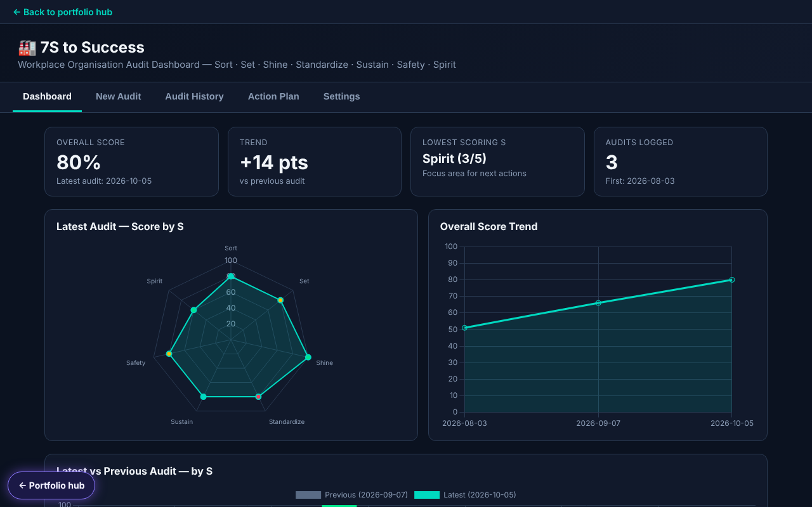

# 7S Audit Dashboard

*The screenshot uses made-up example audits, not real records.*

[Try it live](https://rmilburn1980.github.io/7s-audit-dashboard/) · [Portfolio hub](https://rmilburn1980.github.io/)

Workplace organisation audit covering Sort, Set, Shine, Standardize, Sustain, Safety and Spirit.

It is a single HTML page with no build step and no server. Data stays in your browser by default.

**Optional exception.** The dashboard can be connected to a Google Sheet through a Google Apps Script URL you enter. If you do, audit entries, including auditor and owner names, are sent to that sheet. Do not connect it without your employer's approval.

Part of my portfolio: https://rmilburn1980.github.io/

The audit is decision support only. A score is not a statement that an area is safe or compliant.
